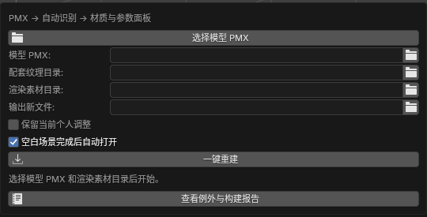
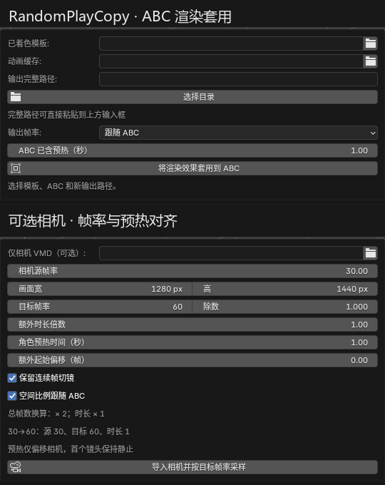
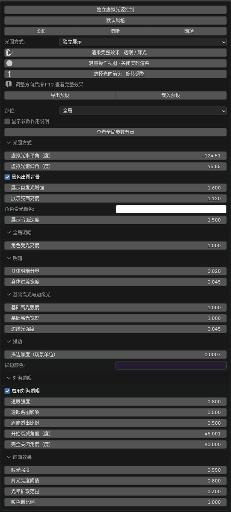
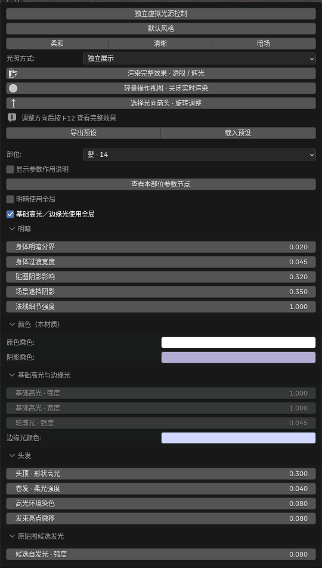

# 面板、按钮与角色参数

3D 视图按 N 打开侧栏。**RandomPlayToon** 制作静态着色模板；**ABC渲染** 将模板效果套用到动画，并管理可选相机。重建后的 Toon 参数页使用角色英文名，Copy 的参数页位于 ABC渲染。

## 激活角色参数面板

打开 Toon 生成的 `.blend` 后，把任意窗口切换为 **文本编辑器**，在顶部的文本列表中选择 **`01_启用风格面板`**，点击 **运行脚本**。也可以把鼠标放在文本编辑器内，按 **Alt+P**。

运行一次后，回到 3D 视图按 **N**，就能在角色英文名对应的侧栏中调整参数。这一步不会重新导入模型或重建材质。重新启动 Blender 后，如果面板没有出现，再运行一次。

更新安装版插件后，请重启 Blender，或禁用后重新启用插件，让新面板生效。使用工程内置面板时，在更新后的工程中重新运行 **`01_启用风格面板`**。

## 构建入口

| Toon | Copy |
| --- | --- |
|  |  |

Toon 的四个文件入口分别是 PMX、配套纹理根目录、渲染素材目录和输出 `.blend`。**一键重建** 完成自动识别和节点构建；**打开重建结果** 切换工程；**查看例外与构建报告** 查看匹配及处理结果。已有着色场景可以勾选 **保留当前个人参数** 后重建。

Copy 的三个文件入口分别是保存好的模板、ABC 和输出 `.blend`。**选择目录** 帮助填写输出位置；**将渲染效果套用到 ABC** 校验并生成工程；**打开结果** 切换工程。**输出帧率** 按秒换算时间轴，**ABC 已含预热（秒）** 供相机对齐使用。任务完成前，结果按钮尚未显示。

## 风格入口

以下截图展示薇薇安的全局和头发参数分组，按钮名称与行为以下表为准。参数按角色和部位生成；其他角色不会出现与其材质无关的控制。

| 全局参数 | 头发部位参数 |
| --- | --- |
|  |  |

| 按钮／控件 | 作用 |
| --- | --- |
| 默认模式（场景光照）／独立虚拟光源控制 | 只切换光照方式，保留当前光向、颜色、亮块、透眼、高光、辉光等设置；重复点击也不会重置 |
| 柔和／清晰／暗场 | 只调整相关明暗、高光、描边或发光强度，保留其他设置；具体范围见下方“光照与风格切换” |
| 重置全部风格参数 | 恢复工程保存的全部初始风格值，包括光照方式；需要保留微调时先导出个人预设 |
| 光照方式 | 选择独立展示光照或场景实际灯光，适配展示与场景制作 |
| 渲染完整效果 · 透眼 / 辉光 | 执行 F12 渲染，查看包含眼部可见性层和后期的最终结果 |
| 轻量操作视图 · 关闭实时渲染 | 切换轻量视口，便于编辑；此视口不显示最终合成 |
| 选择光向箭头 · 旋转调整 | 选中光向控制器，用 R 旋转调整受光方向；平移不改变光向 |
| 导出预设／载入预设 | 将个人参数保存为 JSON，或载入保存的参数 |
| 部位 | 选择全局、脸、皮肤、头发、服饰等材质分区，查看相应控制 |
| 显示参数作用说明 | 在面板中展开当前参数的用途说明 |
| 查看全局参数节点／查看本部位参数节点 | 在着色器编辑器定位面板实际控制的节点 |
| 明暗使用全局／基础高光、边缘光使用全局 | 部分部位可继承全局值，或改用本部位值 |
| 肤色同步到脸和皮肤 | 在提供该按钮的皮肤部位，将当前肤色乘色同步到其他皮肤材质 |

载入 JSON 预设会替换文件中保存的风格数值；柔和、清晰、暗场按钮只做局部调整。需要保留微调时先导出个人预设，调整后保存 `.blend`。修改节点不会自动重渲染已有 F12 图片，需再次渲染。

## 薇薇安示例预设

仓库提供两份普通版薇薇安的参数文件：[冷紫柔光](../presets/vivian/cool-glow.json) 和 [清晰色块](../presets/vivian/crisp-cel.json)。它们只保存面板参数，不包含模型、纹理或渲染素材，也不会修改网格和贴图。

1. 使用 Toon 0.9.0 或更新版重建普通版薇薇安，打开生成的工程。安装插件不会自动更新旧工程的节点。
2. 在文本编辑器运行 **`01_启用风格面板`**，回到 3D 视图的角色参数页。
3. 先保存工程；如果已有个人调整，点击 **导出预设** 留一份备份。
4. 下载对应的 `.json` 文件，点击 **载入预设**，选择该文件。
5. 按 **F12** 查看最终辉光和透眼效果，继续微调后保存工程。

冷紫柔光加强粉紫亮边、光晕和头发高光；清晰色块减少辉光和反光，强调明暗分界与描边。它们需要普通版薇薇安对应的材质与完整控制，其他角色不能直接照搬。JSON 只保存面板参数；展示图还受工程的灯光、渲染采样和局部描边设置影响，这些不会随 JSON 一起载入。

## 全局参数的用途

| 参数 | 调整什么 |
| --- | --- |
| 独立展示光照 | 控制独立光照分支；配合“光照方式”使用 |
| 角色受光颜色 | 独立光照下对受光、阴影及反光乘色；白色保留原色，自发光和描边另行控制 |
| 展示亮面亮度／展示暗面深度 | 增强独立光照的明面亮度或暗面深度，改变整体对比 |
| 展示自发光增强 | 独立展示下增强原贴图发光遮罩，不改变角色原色 |
| 黑色出图背景 | 最终合成铺黑色背景并输出不透明 Alpha；关闭可保留原透明背景 |
| 虚拟光水平角／虚拟光俯仰角 | 改变卡通受光方向，也可以旋转光向箭头 |
| 角色受光亮度 | 调节整体材质受光强度 |
| 身体明暗分界 | 移动亮暗分界，改变阴影覆盖范围 |
| 身体过渡宽度 | 控制明暗边缘硬度；小值更接近硬边卡通阴影 |
| 基础高光强度／基础高光宽度／边缘光强度 | 调整卡通高光强度、面积和掠视角亮边，不同部位可独立控制 |
| 描边厚度／描边颜色 | 调整轮廓壳厚度与颜色；厚度受模型尺寸影响 |
| 启用刘海透眼 | 开关最终透眼混合，保留场景的遮挡结构 |
| 透眼强度 | 控制眼睛穿过指定前刘海的显现程度 |
| 透眼贴图影响 | 控制透眼结果受刘海贴图信息影响的程度 |
| 眉睫透出比例 | 调节眉毛、睫毛在透眼合成中的显现比例 |
| 开始衰减角度／完全关闭角度 | 从正面向侧面观察时，指定透眼开始变弱和停止的角度 |
| 辉光强度／辉光亮度阈值 | 控制后期光晕强度和开始产生光晕的亮度 |
| 光晕扩散范围／暖色调比例 | 调整光晕扩散和最终合成的整体暖色倾向 |

## 部位参数的用途

| 类别与参数 | 调整什么 |
| --- | --- |
| 原色乘色／阴影乘色 | 分别调整基础色和阴影色；可给不同服饰设独立色调 |
| 部位亮度 | 单独提升或降低所选部位的亮度 |
| 明暗分界／过渡倍率 | 给该部位设置阴影范围与柔和度 |
| 贴图阴影影响／场景遮挡阴影 | 调整已匹配阴影控制图和 EEVEE 场景遮挡的影响 |
| 法线细节强度 | 调整纹理法线对表面明暗细节的影响 |
| 高光强度／宽度／部位高光倍率 | 调整部位高光的显眼程度和面积 |
| 金属、皮革反光强度／粗糙度／反光亮度上限 | 调整对应遮罩内的反光能量、宽度和峰值 |
| 头顶形状高光／卷发柔光强度 | 分别控制贴图定义的头顶高光与发卷宽柔光 |
| 高光环境染色 | 独立展示光照下，让发束高光少量接收真实灯光和环境的颜色 |
| 发束亮点微移 | 随虚拟光俯仰微调高光内部亮度重心，不移动纹理 UV |
| 自发光强度 | 调整眼睛、宝石或饰件等配置部位的发光，配合后期辉光使用 |
| 发光颜色／使用自定遮罩／自定发光遮罩 | 设置发光颜色，可在节点中连接黑白图限定发光区域 |
| 候选自发光强度 | 调整已有素材中接入的发光遮罩分支，与新增饰件发光分别控制 |
| 眼球动态高光／目光亮度、不透明度／目影强度 | 分别控制额外眼部亮点、原高光图层与眼部阴影叠层 |
| 表面不透明度 | 调整支持透明的材质表面 Alpha；刘海透眼由单独参数控制 |
| 部位描边倍率／描边色 | 单独调节该部位的轮廓表现 |
| 脸部阴影边界、柔和度／鼻部阴影／下颌阴影 | 调整跟随头部与光向的面部阴影结构 |
| 丝袜褐色深度、高光宽度、强度、底肤色近似、细织纹 | 调整丝袜底色、亮带和织纹；底肤色是艺术近似，仍保持不透明 |
| 宝石切面闪光、内部亮度、有色透光／切面乘色 | 调整已有切面、内色和透明近似，不执行物理折射 |
| 胸前、背部宝石发光／内光切面对比、深浅层次／发光染色比例 | 独立控制宝石内光，保留原有明暗与切面 |
| 跟随展示自发光增强 | 决定专属宝石内光是否额外叠加全局展示增强 |

材质乘色、法线、高光等作用于节点；透眼和辉光还涉及视图层与合成器。用最终渲染判断参数效果，普通实体视口不显示完整效果。

## Copy 相机与时间轴

| 控件 | 作用 |
| --- | --- |
| 仅相机 VMD | 选择含相机轨道的 VMD；角色动作仍读取 ABC |
| 相机源帧率 | 文件自身的帧率，常见原始相机为 30 fps；已按 60 fps 烘焙的文件填 60 |
| 画面宽／高、目标帧率／除数 | 设置输出分辨率和场景有效帧率 |
| 额外时长倍数 | 额外缩放镜头时长；正常帧率换算保持 1，值 2 表示镜头放慢一倍 |
| 角色预热时间（秒） | 将相机延后到已有缓存预热结束，预热期间保持首镜头 |
| 额外起始偏移 | 额外移动相机的起始帧，处理动作与镜头起点差异 |
| 保留连续帧切镜 | 保留稀疏相机关键帧中的硬切；相机已逐帧烘焙时可关闭 |
| 空间比例跟随 ABC／空间比例 | 将 PMX 相机坐标转换到角色缓存的场景尺寸 |
| 导入相机并按目标帧率采样 | 将 VMD 相机轨道生成 Blender 原生相机动画 |
| 按上述设置重新对齐相机 | 从工程保存的源轨道重新采样，替换本工具相机的手动调整 |
| 同步 ABC 时间轴到当前帧率 | 帧率改变后同步头部控制、时间轴范围和已导入相机 |

相机对齐关系为：

```text
目标帧 = 源帧 × 目标 fps / 源 fps × 额外时长倍数
       + 预热秒数 × 目标 fps + 额外起始偏移
```

例如源相机 30 fps、场景 60 fps、时长倍数 1、预热 1 秒：帧号乘 2 再加 60，镜头本身的秒数不变。相机对齐不会重算角色动作或物理。用户另加的灯光、物体动画需自行对齐。
## 亮块、描边、高光与眼部发光

这些控制在对应分组中调节，可以保存、设关键帧和导出个人预设。旧工程若没有这些参数，需要用新版 Toon 重新构建。Copy 0.8.4 或更新版可显示新模板的参数，角色和 ABC 的输入要求见 [工作流程](WORKFLOW.md#copy-输入目录)。

| 分组 | 控件与行为 |
| --- | --- |
| 全局 → 独立亮块 | **启用独立亮块** 默认关闭。水平角、俯仰角独立于主光；颜色、强度、宽度和边缘柔度分别可调。方向箭头显示当前方向。 |
| 全局 → 独立亮块 | **启用亮块辉光** 可单独关闭。强度、范围和阈值控制亮块周围的光晕，不会把白衣或原头发高光也作为这层辉光的来源。 |
| 部位 → 独立亮块 | **部位亮块倍率** 控制该部位的亮块强弱，设为 0 可关闭。眼睛、眉睫、嘴部和原特效材质不加亮块。它用于调风格，不会像场景灯一样投射阴影。 |
| 全局 → 描边 | **启用贴合视角描边** 默认开启；**描边最大像素宽度** 限制加粗后的外扩，**描边视角变化** 控制轮廓随视角的变化程度。支持正交、透视和切换场景相机；用渲染相机和 F12 检查效果。 |
| 头发部位 → 头发 | **原贴图高光扩缩（像素）** 调整现有亮带：正值扩宽，负值收窄，范围 −12～12，以 1024 贴图为基准；0 保留原形状。**原贴图高光倍率** 调整强度，默认 1。 |
| 全局 → 眼部自发光 | **瞳孔自发光强度／瞳孔发光颜色** 与 **眼白自发光强度／眼白发光颜色** 分开调节，强度默认 0；与透眼比例独立，不让眉睫、眼影、嘴线和额外眼高光贴片一起发光。 |

辉光会扩散到相邻区域。想单独检查瞳孔或眼白的发光范围时，可以先关闭画面辉光。旧版个人预设仍可载入，缺少的控制会补上默认值。

普通版薇薇安和南宫羽·狂想缪斯已验证这些控制。两份薇薇安预设的使用方法见 [示例预设](#薇薇安示例预设)。


## 光照与风格切换

“默认模式（场景光照）”“独立虚拟光源控制”和光照方式下拉菜单只切换光照模式，其他参数保持当前值。柔和、清晰、暗场从当前参数做局部调整：

| 风格 | 调整范围 |
| --- | --- |
| 柔和 | 明暗过渡、脸部阴影柔和度、基础高光和边缘光 |
| 清晰 | 明暗过渡、脸部阴影柔和度、基础高光、边缘光和描边宽度 |
| 暗场 | 受光亮度、画面辉光强度与阈值，以及相关部位的自发光强度 |

未涉及的光照模式、光向、颜色、刘海透眼、独立亮块和发束高光扩缩等设置都会保留。只有 **重置全部风格参数** 会恢复全部初始值。Toon 和 Copy 使用相同的切换规则。

## 透眼、阴影采样与粗描边

薇薇安透眼同时检查刘海覆盖、眼部可见性、深度和侧视角，场景光照与独立光源模式都可使用。按 F12 查看完整合成结果。

README 中的清晰色块展示工程保留间接光，并提高了 EEVEE 间接光、阴影与最终渲染采样，最终采样为 512；阴影颗粒更少，但渲染更慢。工程还限制了嘴部附近的描边膨胀，并降低发片扩张。极粗线宽下，薄发片仍可能出现交叠。

采样和这些局部描边调整属于展示工程设置，未作为安装包的通用构建默认值；JSON 风格预设也不保存这些设置。


### 0.9.4：薇薇安脸部独立亮度

全局 → 脸部独立亮度新增两组独立跟随开关与数值。默认全部跟随全局，初始独立值取当前全局值；跟随期间面板显示当前全局值且不可独立编辑。关闭对应跟随后才能调整脸部亮度。脸部角色受光亮度作用于两种光照模式；脸部展示亮面亮度仅作用于独立光源模式。颜色、眼部自发光、亮块和衣服等其他部位不改。两个脸部材质共享控制，原颈部过渡沿用脸部贡献以保持接缝连续。局部风格预设保留这些新增设置；重置全部参数恢复默认跟随状态。当前先支持薇薇安专用材质链，通用角色构建不改。Copy 0.8.8 同步参数面板。


### 0.9.5：脸部亮度入口归入部位

脸部独立亮度从全局面板移到“颜”和“颜2”部位面板。两个入口操作同一组脸部参数，避免面部接缝两侧亮度不一致。仅改变面板布局，节点存储、参数值、跟随逻辑与已有预设格式不变。Copy 0.8.9 同步布局。

## 场景光照响应（Toon 0.9.10）

“默认模式／场景响应”通过 EEVEE 实际光照采样控制基础卡通明暗、受光颜色和亮度。修改场景灯光颜色、能量、位置或朝向会影响角色；多盏灯共同参与，脸部使用原有平滑方向场。原贴图与阴影乘色仍参与最终颜色，因此不是写实材质或直接复制灯光 RGB。

0.9.9 修复颜色接入后的阴影颗粒回归：0.9.8 在卡通明暗之后又乘了一次原始照度亮度，把分段前的细碎阴影重新带回画面。现在亮度只走卡通明暗，颜色分支使用 `(RGB + 0.03) / (max(RGB) + 0.03)`，白光不额外压暗，暗处的微小颜色差异不会被除以接近零的值放大。关闭灯光时仍保留艺术化阴影色和独立自发光。更新已有 0.9.8 工程会替换颜色分支，不重复添加明暗节点。

0.9.10 的复核修复：通用头发的整层亮度／亮部柔化分支不再重复乘场景颜色，独立展示的原分支保留；较早的 Vivian 实验工程接入同一套明暗计算，恢复鼻部／下颌局部阴影、控制图明暗偏置，并让 Lit Factor 与可见明暗一致。场景阴影柔度不再强制限制为至少 0.08，较小数值可以继续调细。同步删除仅属于场景响应、已断开输出的计算节点。

主阴影方向在场景响应中由真实灯光控制，在独立展示中由虚拟光向控制。“风格化鼻影”的形状仍由鼻影独立方向及视角控制，灯色只通过已受光肤色影响其颜色。刘海透眼遮罩不依赖受光颜色；这些设置在光照方式切换时保留。

新建角色自动接入。已经生成的工程，在 **RandomPlayToon → 更新当前工程的场景光照响应** 点击一次，再保存工程即可；安装 ZIP 本身不会改写旧工程。已有 Vivian 场景响应实验节点会被识别，避免重复乘色。Copy 继续继承模板内的材质节点，先更新模板再套用 ABC 即可。

正式实现还纠正了实验脚本的脸部采样法线：按节点连接找到随头部转动的方向场，不再把 `NORMALIZE.001`（实际是灯光方向）当作脸部法线。旧实验工程升级时也会修正该连接。

切换回独立虚拟光源时保留原着色分支。升级与切换都不重置已有参数；独立亮块、眼部自发光、其他自发光、描边、刘海透眼及鼻影保持各自控制。发束图形高光和附加反光在场景模式下也接受颜色。解析高光形状仍沿用原方向算法，并非逐灯计算的物理镜面反射。

世界／HDRI 的影响取决于 EEVEE 实际提供给材质的环境照明；单独改合成背景颜色不等于改环境光。在材质预览中测试时需启用“场景灯光／场景世界”，最终效果以 EEVEE 渲染为准。不会自动修改采样数、灯光、世界、相机或合成器。

## 通用风格化鼻影（Toon 0.9.6 / Copy 0.8.10）

在部位列表选择 **颜**，展开 **风格化鼻影**。如果模型有颜／颜2，两处显示的是同一套鼻影参数。新版构建默认关闭；开启后，鼻影随相机相对头部的角度连续改变位置和形状，接近侧脸或极端俯仰角时淡出。它是艺术化的视角效果，不是灯光投射阴影，也不是恢复出的游戏脸部 SDF。

鼻尖位置由已识别的脸、眼睛和嘴部网格自动计算；尺寸按脸宽归一化，无角色名称分支或固定世界坐标。支持原有骨骼、表情及保持拓扑的 ABC 变形。未知／不可靠的脸部结构会跳过并记录原因，不强行画上鼻影。

| 参数 | 作用 |
| --- | --- |
| 启用风格化鼻影 / 鼻影强度 | 单独开关与混合强度；关闭或强度为 0 时保留原着色 |
| 鼻影乘色 | 乘以当前脸部颜色，建议使用柔和的肤色阴影色 |
| 鼻影宽度 / 长度 | 相对自动识别尺寸的倍率 |
| 鼻影左右 / 上下偏移 | 按脸宽比例微调自动定位 |
| 鼻影边缘柔度 | 调整硬边与柔边过渡 |
| 鼻影独立方向 | 单独指定鼻影偏向，正负值选择正面时的不同侧；默认 35°，不改变主光 |
| 鼻影视角跟随 / 换侧过渡 | 跟随为 0 时固定侧向；为 1 时随视角换侧。换侧先淡出再出现，避免正面中央色块 |
| 鼻影侧脸淡出 | 设置开始淡出的水平视角 |

默认／独立光源、柔和／清晰／暗场按钮保留鼻影设置；“重置全部风格参数”会恢复默认关闭。鼻影不修改眼部、嘴线、描边、亮块 AOV 或合成器。实际渲染仍经过原工程的辉光、调色等后期。

本轮八角色示例和画面对比位于 `experiments/NoseShadow/index.html`。ABC 验证遵守 Copy 原有的角色、拓扑与缓存约束，不因新增鼻影而扩展可接受的缓存种类。

### 0.9.7：鼻影参数即时更新

修复鼻影控件数值变化但跨材质驱动仍保留旧值的问题。鼻影面板现在把修改写入原节点输入后立即刷新依赖，参数只保存一份；不需要切帧或切换风格来触发。尺寸、颜色、方向、强度和开关均适用。Copy 0.8.11 同步修复。已有鼻影参数和实际节点上的关键帧继续保留；需要制作鼻影参数动画时在实际控制节点输入上设置关键帧。

已打开的旧面板需升级插件，或重新运行文件里的 `01_启用风格面板`。渲染结果窗口展示的是上次出图，仍需 F12 重新渲染；渲染视口会随参数变化更新。

回归测试：`python_scripts/generalization/tests/test_nose_live_controls.py`，在后台 Blender 中运行，并在 `--` 后传入含鼻影的静态／ABC 工程路径。测试直接调用面板属性接口，不额外刷新，再检查实际材质驱动与预设保留行为。
